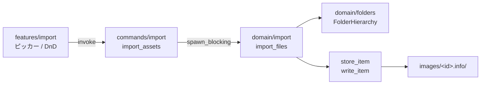
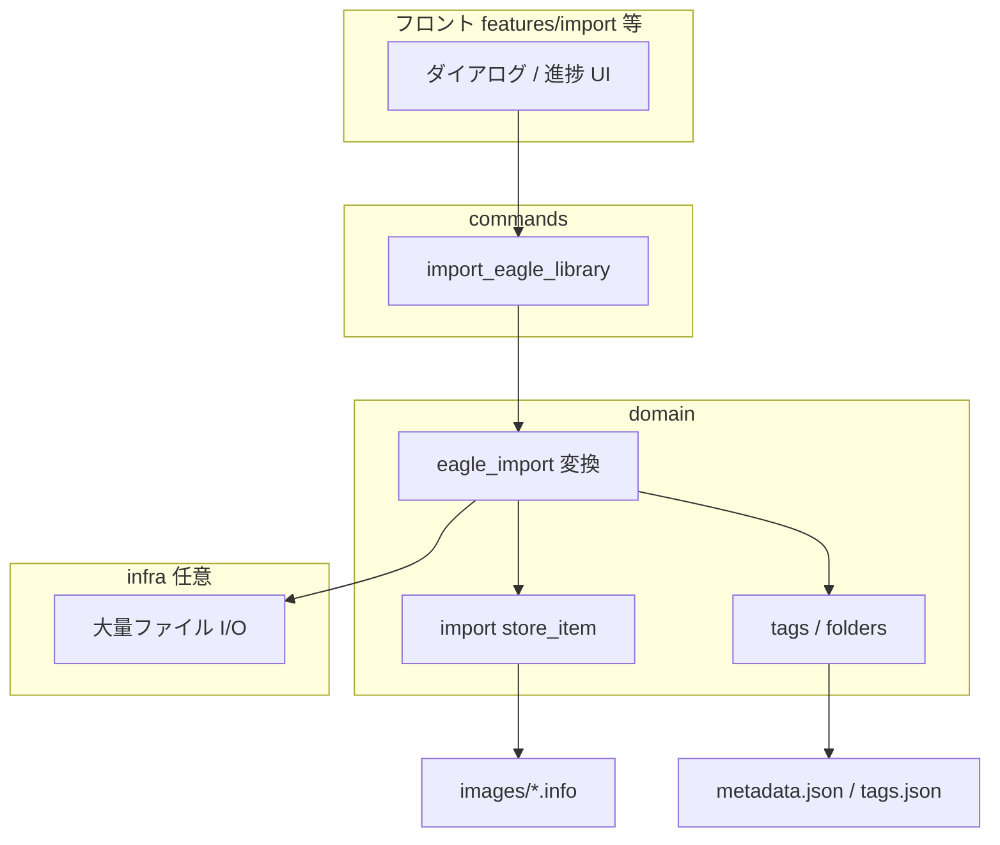

# インポータ構造と拡張ポイント

最終更新: 2026-11-13  
対象: Swallow の取り込みパイプラインと、Eagle 等の外部フォーマットインポータを追加するときのレイヤー分担。

関連: [eagle-vs-swallow.md](./eagle-vs-swallow.md)（#57 Eagle 移行）、[HANDOFF.md](./HANDOFF.md)

## 概要

取り込みの**永続化の正本**は `domain::import` にあり、各アイテムは `images/<id>.info/` 以下に実ファイルと `metadata.json` を**ステージング後にリネーム**して原子的に配置する。`ItemMetadata` は Rust（`domain::item`）と TypeScript（`packages/shared/src/library/library.ts`）で同一スキーマを共有しており、インポート時点からタグ・フォルダ・注釈・星・URL など**一式のフィールドを持てる**が、現行のファイル／バイト取り込みは多くのフィールドを初期値のまま書き込む。

`infra/storage.rs` のような専用ストレージモジュールはなく、ライブラリ直下 JSON の原子書き込みは `domain::library::write_json_atomic`、既存アイテムの `metadata.json` 更新は `domain::item::item_io::save_item` が担う。

---

## 1. 現在の取り込みの入口とデータフロー

### 1.1 レイヤー一覧

| 層               | 主なパス                                                 | 役割                                           |
| ---------------- | -------------------------------------------------------- | ---------------------------------------------- |
| フロント         | `apps/desktop/src/features/import/`                      | ダイアログ・DnD・`ImportReport` の表示         |
| Tauri コマンド   | `apps/desktop/src-tauri/src/commands/import.rs`          | `import_assets`（ファイルパス取り込み）        |
| ドメイン         | `apps/desktop/src-tauri/src/domain/import.rs`            | `import_files` / `import_bytes` / `store_item` |
| HTTP（拡張連携） | `apps/desktop/src-tauri/src/infra/http_api.rs`           | POST で本文バイトを `import_bytes` に渡す      |
| 共有型           | `packages/shared/src/import/`（`import.ts`・`index.ts`） | `ImportReport`・`SUPPORTED_IMPORT_EXTENSIONS`  |
| 共有型           | `packages/shared/src/library/library.ts`                 | `ItemMetadata`                                 |

### 1.2 `import_files`（ローカルファイルパス）

**公開 API**

- Tauri: `import_assets(library_path, paths)` → 内部で `domain::import::import_files`
- フロント: `features/import/api.ts` の `importAssets` → `hooks/useAssetImport.ts`（ピッカー・ディレクトリ選択・グリッドへの DnD）

**処理の流れ**

1. `<library>/images/` の存在を確認する。
2. 各 `paths` エントリについて:
   - **通常ファイル**: `import_one` で 1 アイテム化（フォルダ未割り当て）。
   - **ディレクトリ**: `FolderHierarchy` でライブラリルート `metadata.json` のフォルダツリーを更新し、配下を再帰走査。サブフォルダ名に対応するフォルダ ID を `ensure_child` で確保し、取り込んだアイテムの `folders` にその ID を入れる（ディレクトリをドロップしたときの階層ミラー）。
3. 成功分は `ImportReport.imported`、失敗分は `ImportReport.failed`（パス単位で継続）。
4. フォルダツリーに変更があれば `hierarchy.save_if_dirty()`。

**メタデータの生成（現行）**

- ファイル名（stem）→ `name`、拡張子 → `ext`（小文字）
- `imagesize` / SVG パーサで `width` / `height`（PDF は null）
- 新規 ULID → `id`、`now_millis()` → `created_at` / `modified_at`
- `tags`・`annotation`・`url` は空、`star` は 0、`color_label` は null（ディレクトリ取り込み時のみ `folders` が埋まる）

対応拡張子は `SUPPORTED_EXTENSIONS`（`png` / `jpg` / `jpeg` / `webp` / `gif` / `svg` / `pdf`）。`packages/shared` の `SUPPORTED_IMPORT_EXTENSIONS` と対で維持される。

### 1.3 `import_bytes`（バイト列・HTTP API）

**公開 API**

- Tauri コマンドは**ない**。`infra/http_api.rs` のアイテム追加ルート（Chrome 拡張向けループバック API）が本文を読み、`import::import_bytes` を呼ぶ。
- 入力は `BytesImport { name, ext, url, bytes }`。

**処理の流れ**

1. 拡張子の検証（クエリ `ext` または `Content-Type` から推論）。
2. `new_item` で `ItemMetadata` を組み立て（`url` クエリがあれば `ItemMetadata.url` に格納）。
3. `store_item` で永続化し、単一の `ItemMetadata` を返す（部分失敗レポートは無い）。

### 1.4 `store_item` と on-disk 布局

`domain/import.rs` 内のプライベート関数 `store_item` が、**新規取り込み専用**の書き込みパスである。

1. `images/<id>.info.tmp/` を作成（読者が未完成ディレクトリを見ないためのステージング）。
2. `write_item`:
   - 実ファイルを `images/<id>.info/<name>.<ext>` にコピーまたは `write`
   - `metadata.json` に `serde_json::to_vec_pretty(item)` で**完全な `ItemMetadata`** を書き込み
3. `fs::rename` で `.tmp` → `.info`。失敗時はステージングを削除。

既存アイテムのメタデータだけを変える経路（インスペクター編集など）は `domain::item::update_item` → `save_item`（`write_json_atomic` のみ）であり、バイナリ本体は触らない。

**設計上の含意**: 外部インポータが Eagle のメタデータを Swallow の `ItemMetadata` にマッピングできれば、**同じ `write_item` / `store_item` 相当の経路**でリッチな初回書き込みが可能。現状 `new_item` は import 専用の簡易ビルダーなので、Eagle 向けには別ビルダーか `ItemMetadata { ... }` の直接構築が想定される。アイテム型の正本は `domain/item/mod.rs`（I/O は `domain/item/item_io.rs` の `save_item`）。

### 1.5 `ItemMetadata`（共有契約）

`packages/shared/src/library/library.ts` と `domain::item::ItemMetadata` はフィールドが対応する（camelCase JSON）。

| フィールド                                   | 用途（インポータ視点）                                          |
| -------------------------------------------- | --------------------------------------------------------------- |
| `id`                                         | 新規は ULID。移行時に ID を維持するかはポリシー次第             |
| `name` / `ext` / `size` / `width` / `height` | ファイル本体から取得 or Eagle からコピー                        |
| `tags`                                       | アイテム側のタグ名リスト（ライブラリ `tags.json` と整合が必要） |
| `folders`                                    | フォルダ ID の配列（ルート `metadata.json` のツリー内 ID）      |
| `annotation`                                 | メモ・コメント                                                  |
| `star`                                       | 0–5                                                             |
| `colorLabel`                                 | 色ラベル（Swallow 側型は `color-label` ドメイン）               |
| `url`                                        | ソース URL                                                      |
| `createdAt` / `modifiedAt`                   | Eagle の日時を引き継ぐか、`now_millis` か                       |
| `isDeleted`                                  | ゴミ箱相当の移行で true にするか                                |

---

## 2. 新しいインポータが差し込む場所

Eagle ライブラリ（`.library` ディレクトリ）など**外部フォーマット**を読むインポータは、既存の「単一ファイル／バイト」取り込みの上に、次の分担で足すのがモジュール境界（`AGENTS.md`）に沿う。

### 2.1 `domain` — 外部メタデータ → `ItemMetadata`

- **新規モジュール例**: `domain/eagle_import.rs`（または `domain/import/eagle.rs`）
- 責務:
  - Eagle の `metadata.json` / SQLite / 付属 JSON 等を読み、1 アイテム分の Swallow `ItemMetadata` とバイナリの所在（コピー元パスまたはバイト）を決める
  - Eagle フォルダ ID → Swallow `Folder` ツリー（新規 ULID または決定的マッピング）への変換
  - Eagle タグ名 → 正規化（`domain::tags::normalize_names` と同様のルール）
- **既存コードの再利用**:
  - 寸法計算: `import` 内の `dimensions` と同ロジック（共通化は後続リファクタ可）
  - フォルダ永続化: `FolderHierarchy`（`domain/folders.rs`）
  - タグ辞書: `domain::tags::load` / `update`（アイテム側 `tags` と `tags.json` の両方）

ドメインは `commands` / `infra` / Tauri に依存しない。

### 2.2 `domain::import` / `item` — 永続化

- 現行は `store_item` が `domain/import.rs` に閉じている。Eagle 一括取り込みでは次のいずれかが必要になりやすい:
  - `store_item`（または `write_item`）を `domain::import` の `pub` API に上げ、任意の `ItemMetadata` + `Content` で保存する
  - または `domain::item::tests` で使われている `write_item` 相当を共有関数化する
- バッチ取り込みでは**アイテムごとに `store_item`、最後にフォルダ・タグ JSON を一度保存**するトランザクション戦略（中途失敗時のロールバック方針）をドメインで決める。

### 2.3 `infra` — I/O と長時間処理の境界

- Eagle ライブラリパス配下の大量ファイル読み出し、進捗イベントの発火（Tauri イベントやチャンク返却）は `infra` が適切（`http_api` と同様、`domain` だけを呼ぶ）。
- HTTP 経由で取り込む必要は通常なく、デスクトップの専用コマンドが主になる想定。

### 2.4 `commands` — Tauri コマンド公開

- 例: `import_eagle_library(library_path, eagle_library_path)` → `spawn_blocking` でドメインのオーケストレーションを実行
- 戻り値は `ImportReport` の拡張（スキップ理由の列挙、インポート済みフォルダ数など）か、専用の `EagleImportReport` を `packages/shared` に追加
- `commands/mod.rs` の `swallow_invoke_handler!` 登録と、CI の `tauri-command-contract.mjs` 更新が必須

### 2.5 フロント `features/import`（または新 feature）

- ライブラリ選択ダイアログ、進捗バー、完了後の `invalidate`（`useAppSession` の `refreshAfterImport` と同様に items + folders を再読込）
- 既存の `ImportReportBanner` はファイル取り込み向け。Eagle は件数が大きいため、キャンセル・ログ・部分成功の UX を別コンポーネントに分ける余地あり
- IPC は `features/<domain>/api.ts` に `invoke` を置く（境界ルール）

---

## 3. 将来必要になる拡張（Eagle 等のリッチインポータ）

現行の `import_files` / `import_bytes` は下表のとおり**スキーマは持つが取り込み時は未設定**が多い。Eagle 移行（#57）では、変換レイヤーとライブラリ全体の JSON 同期を明示的に設計する必要がある。

### 3.1 タグ

| 現状                                                        | Eagle 移行で必要なこと                                                                                                         |
| ----------------------------------------------------------- | ------------------------------------------------------------------------------------------------------------------------------ |
| 取り込み時 `tags: []`                                       | Eagle のタグ文字列を `ItemMetadata.tags` に写入                                                                                |
| `tags.json` は UI の `add_tag` / `add_item_tags` 経由で同期 | 一括インポート時に `domain::tags::update` で未知タグを `LibraryTags.tags` にマージ（`add_item_tags` と同様、タグ辞書へも登録） |
| タググループ                                                | Eagle のグループ構造があれば `TagGroup` へのマッピングと `set_tag_group` 相当の一括適用                                        |

**注意**: アイテムだけ `metadata.json` にタグを書いても、サイドバーのタグ一覧が空のままになる。辞書側の更新はインポータの責務に含める。

### 3.2 注釈（`annotation`）

| 現状                              | 拡張                                                                                                         |
| --------------------------------- | ------------------------------------------------------------------------------------------------------------ |
| フィールドあり、取り込み時は `""` | Eagle の description / annotation をそのまま `annotation` にコピー可能（長文・改行のエスケープは JSON 任せ） |

追加の型変更は不要。変換器のみ。

### 3.3 星・評価（`star`）

| 現状                                    | 拡張                                                                       |
| --------------------------------------- | -------------------------------------------------------------------------- |
| 0–5、`MAX_STAR` で検証（`update_item`） | Eagle の rating が段数・スケール違いなら変換テーブル（例: 0–5 へクリップ） |
| 取り込み時は常に 0                      | 初回 `store_item` 時に Eagle 値を設定可能                                  |

`ItemMetadata` の拡張は不要。Eagle 独自の「お気に入りフラグ」だけの場合は `star` へのマッピング規則をドキュメント化する。

### 3.4 フォルダ階層

| 現状                                                                     | 拡張                                                                                                                                                                   |
| ------------------------------------------------------------------------ | ---------------------------------------------------------------------------------------------------------------------------------------------------------------------- |
| ローカル**ディレクトリ**をドロップしたときのみ、フォルダツリーを自動作成 | Eagle のフォルダ一覧は別データソース。全フォルダを先に `FolderHierarchy` で作成し、各アイテムの `folders` に Eagle 所属フォルダに対応する Swallow フォルダ ID を入れる |
| 単一ファイル取り込みは `folders: []`                                     | 複数フォルダ所属（Eagle がサポートする場合）は `folders: Vec<String>` をそのまま使える                                                                                 |

ルート `metadata.json` の `folders` ツリーと、各アイテムの `folders` ID の**一貫性**がインポート完了条件になる。

### 3.5 その他（移行で触れやすい項目）

- **`colorLabel`**: Swallow は型があるが Eagle 色ラベルとの対応表が必要（未対応なら null）
- **`url`**: `import_bytes` / HTTP API と同様、Eagle の元 URL があれば設定
- **`createdAt` / `modifiedAt`**: 履歴を尊重するなら Eagle のタイムスタンプを使用（並び順・ソートに影響）
- **`isDeleted`**: Eagle のゴミ箱アイテムを移行する場合、true で取り込むか除外するかポリシー決定
- **ID の扱い**: 新規 ULID（現行と同じ）か、決定的 ID で再実行時の冪等性を取るか
- **進捗・キャンセル・エラー報告**: `ImportReport` はファイルパス失敗向け。Eagle 用にはアイテム ID / Eagle パス / 理由コードを持つレポート型の追加が現実的
- **`store_item` の公開化**: ドメイン内重複を避け、リッチメタデータ付き取り込みの単一出口にする

---

## 4. 関連ファイル早見表

| 内容                                 | パス                                                                             |
| ------------------------------------ | -------------------------------------------------------------------------------- |
| ファイル取り込みコマンド             | `apps/desktop/src-tauri/src/commands/import.rs`                                  |
| 取り込みドメイン                     | `apps/desktop/src-tauri/src/domain/import.rs`                                    |
| アイテムメタデータ型                 | `apps/desktop/src-tauri/src/domain/item/mod.rs`                                  |
| アイテム読み書き                     | `apps/desktop/src-tauri/src/domain/item/item_io.rs`                              |
| フォルダツリー                       | `apps/desktop/src-tauri/src/domain/folders.rs`                                   |
| タグ辞書・同期                       | `apps/desktop/src-tauri/src/domain/tags.rs`                                      |
| HTTP バイト取り込み                  | `apps/desktop/src-tauri/src/infra/http_api.rs`                                   |
| フロント API / UI                    | `apps/desktop/src/features/import/`                                              |
| 共有 `ItemMetadata` / `ImportReport` | `packages/shared/src/library/library.ts`, `packages/shared/src/import/import.ts` |

---

## 5. 受け入れ観点（本ドキュメントの利用者向け）

Eagle 等のインポータ実装 PR では、少なくとも次を満たすことを想定する。

1. ドメインで外部形式 → `ItemMetadata` に変換し、`images/<id>.info/` へ原子的に保存する
2. タグ利用時は `tags.json` とアイテム `tags` の両方を更新する
3. フォルダ利用時はルート `metadata.json` のツリーとアイテム `folders` が整合する
4. Tauri / フロント / `packages/shared` の契約テスト（コマンド名・型）を更新する
5. 既存の `import_assets` / HTTP `import_bytes` 経路の挙動を壊さない
